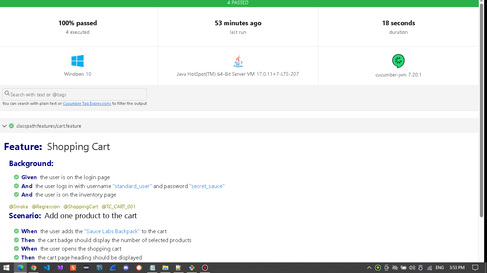
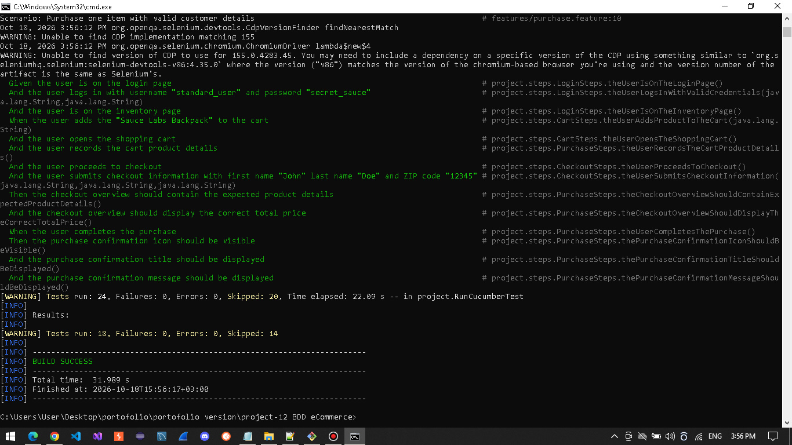

<a id="top"></a>
# 🛒 Project 12 – BDD-eCommerce-App UI Testing Automation Framework 


> **Note 1:** This project is part of my personal QA Automation portfolio.

## Table of Contents  

- [Overview](#overview)
- [Tech Stack](#tech-stack)
- [Framework Features](#framework-features)
- [Framework Architecture](#framework-architecture)
- [Test Execution](#test-execution)
- [Reports and Output](#reports-and-execution-output)
- [Conclusion](#conclusion)

---

## 📖 Overview 

This project is a **BDD-based Web UI Test Automation Framework** developed using Java, Selenium WebDriver, Cucumber, JUnit 5, and Maven.

The framework follows the **Behavior-Driven Development (BDD)** approach, using **Gherkin syntax** to define test scenarios in a readable and structured format. These scenarios are connected to reusable Java Step Definitions that perform browser interactions and validate application behavior.

The framework automates the following **functional modules:**

- Authentication
- Product Catalog
- Shopping Cart
- Checkout Workflows
- Purchase Flows

Both **positive and negative testing scenarios** are covered, including functional validations, input constraints, boundary conditions, and complete user journeys.

The implementation combines **BDD principles** with the **Page Object Model (POM)** design pattern to promote code reusability, maintainability, and separation of concerns.

**Application Under Test:** [SauceDemo](https://www.saucedemo.com/)


---

<a id="tech-stack"></a> 
## 🛠️ Tech Stack 

| Technology | Purpose |
|------------|---------|
| Java | Programming language |
| Selenium WebDriver | Web UI automation and browser interactions |
| Cucumber | BDD implementation using Gherkin scenarios and Step Definitions |
| JUnit | Test execution integration and assertions |
| Maven | Dependency management, build automation, and test execution |
| Cucumber HTML Reports | Test execution reporting |
| GitHub Actions | Continuous Integration (CI) |

---

## ✨ Framework Features

- **Behavior-Driven Development (BDD):** Human-readable test scenarios written in Gherkin using `Given`, `When`, and `Then`.
- **Page Object Model (POM):** Separation of page-specific elements and interactions from test scenarios and Step Definitions.
- **Reusable Step Definitions:** Shared Java step implementations across multiple feature files to reduce code duplication.
- **Cross-Browser testing:** Support for Chrome, Firefox and Edge browsers.
- **Tag-Based Execution:** Selective test execution using Cucumber tags such as @Smoke, @Regression, and module-specific tags.
- **Element Waits:** Custom wait mechanisms for reliable interaction with web elements.
- **Test Reporting:** Detailed reports using Cucumber Reports.
- **Console Output:** Structured execution output directly in the console.
- Test execution control through **Maven parameters**
- **GitHub Actions CI:** Two workflows for automated test execution (one manually triggered and one triggered on Pull Requests).

---

<a id="framework-architecture"></a>
## 🏗️ Framework Architecture

The framework is organized into dedicated layers, each with a clear responsibility to improve
maintainability, reusability, and separation of concerns.

| Component | Purpose |
|-----------|---------|
| Base | Provides shared WebDriver creation and configuration functionality |
| Pages | Encapsulates page-specific locators and user interactions using POM |
| Steps | Implements reusable Cucumber Step Definitions and assertions |
| Features | Defines application behavior and test scenarios using Gherkin syntax |
| Expected | Centralizes expected values used during test validation |
| Utils | Provides reusable utilities, including custom element waits |
| TestHooks | Manages browser initialization and cleanup during the scenario lifecycle |

---

## Test Execution

### Run All Tests (Default - Smoke Suite)

```bash
# All Tests (24 tests)
mvn clean test
```

### Run Specific Test Suite 

```bash
# Smoke Tests (4 tests)
mvn test -Dbrowser=edge -Dcucumber.filter.tags="@Smoke"

# Test Module: Checkout (9 tests) 
mvn test -Dbrowser=edge -Dcucumber.filter.tags="@Checkout"
```

### Run Tests with Browser Selection

```bash
# Chrome browser (default)
mvn clean test -Dbrowser=chrome

# Firefox browser
mvn clean test -Dbrowser=firefox

# Edge browser
mvn clean test -Dbrowser=edge
```

---

## Reports and Execution Output

### Reports

Test execution reports are generated using the **Cucumber HTML reporting plugin** and saved in the `reports/` directory.

The reports provide an overview of executed features and scenarios, including their execution status, individual steps, and failure details.

**Report location:** `reports/cucumber-report.html`

<details>
<summary>📊 <strong>Report Preview</strong></summary>

<br>



</details>

### Execution Output

Cucumber provides detailed execution output directly in the console through its `pretty` formatter.

This output includes feature and scenario names, executed Gherkin steps, execution status, and failure information, helping identify and investigate unsuccessful test scenarios.

Console output is separate from the generated HTML reports.

<details>
<summary>📝 <strong>Console Output</strong></summary>

<br>



</details>


---

## Conclusion

The main focus of this project was to demonstrate the practical understanding of UI Test Automation and **Behavior-Driven Development (BDD)** concepts 
through **Gherkin scenarios** within a structured and configurable framework.

**Author:** [DoruSQA](https://github.com/DoruSQA) | [LinkedIn](https://www.linkedin.com/in/sava-doru/)
<p align="right"><a href="#top">Back to Top</a></p>


